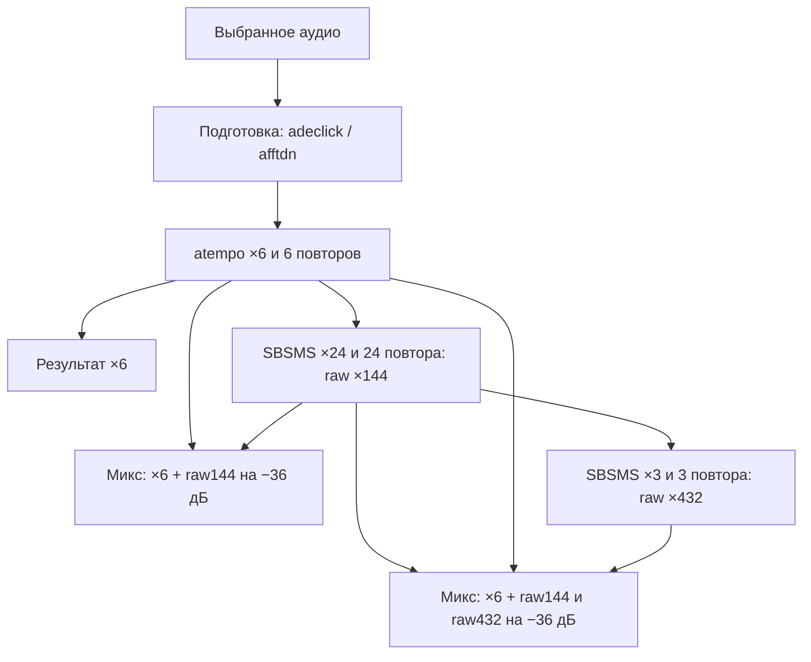

# Fabula Audio: логика приложения и контекст для следующих агентов

Состояние проверено по исходному коду **11 октября 2026 года**. Документ описывает
локальный проект после изменений записи WAV и режимов ×144/×432. Он не означает,
что эти изменения опубликованы или проверены на телефоне пользователя.

## Test6: отмена обработки (11.10.2026)

Пользователь прямо попросил возможность отмены без закрытия приложения.
Во время подготовки для прослушивания и построения ×6/×144/×432 кнопка
«СТОП» становится «ОТМЕНИТЬ». При нажатии отображается «Отмена обработки…»;
кнопки режимов разблокируются только после завершения рабочего потока и очистки.
Во время обычного прослушивания «СТОП» сохраняет прежнее назначение.

- `ProcessingCancellation`: отдельный token на задачу; ThreadLocal связывает
  его только с рабочим потоком этой задачи. FFmpeg получает cancel(sessionId),
  а не глобальную отмену. Учтена отмена между запуском и регистрацией сессии.
- SBSMS вызывает существующий JNI callback после каждого блока 512 кадров;
  Kotlin проверяет token и отправляет проценты в UI только при их изменении.
  CancellationException проходит через JNI; C++ освобождает движок и файлы.
- При копировании исходника проверка отмены выполняется между блоками 64 КиБ.
- После завершения FFmpeg token проверяется до следующего этапа; перед публикацией
  результата также проверяется отмена, включая нажатие после окончания расчёта,
  но до выполнения UI callback.
- Прерванная задача очищает signatures и файлы кэша обработки, отключает
  прослушивание/сохранение результата. Повторный запуск считает заново.
  Экспортированные пользователем файлы и записи первого раздела не удаляются.
- Сохранение готового результата в SAF не входит в новую отменяемую задачу.
  Старые ограничения по жизненному циклу Activity и live-прослушиванию не менялись.
- 10 unit-тестов прошли, включая отмену до регистрации FFmpeg, повторную отмену
  и независимость следующей задачи. Host audio_regression проверяет прерывание
  SBSMS в середине работы, последующий повторный запуск и прежние аудиоинварианты.
- APK `../FabulaAudio-4.32-test6-cancel-arm64.apk`: versionCode=33,
  4.32-test6, com.fabula.audio.test. Тот же ключ test4/test5; установка поверх.
  Проверка на физическом телефоне пока не выполнена.

## Test5: длинный файл и отсутствующий прогресс SBSMS (11.10.2026)

Пользователь прислал скриншот test4: «SBSMS: decode: обработано 1422 с аудио…»
и конкретный файл «Мой масштаб 1_2026-10-07_22-32-27.m4a». Это AAC LC,
44100 Гц, моно, 1422,709841 с (23 мин 43 с), а не MP3.

Подтверждённая ошибка интерфейса: после FFmpeg decode выполнялся синхронный
JNI SBSMS без смены статуса и без callback прогресса. До завершения SBSMS
экран продолжал показывать последнее число секунд декодирования. Поэтому
скриншот сам по себе не доказывал остановку декодера.

Исправление test5:
- Перед SBSMS отображаются название режима и 0%; native `changeTempo` сообщает
  процент по числу созданных кадров, через JNI `ProgressListener.onProgress`.
- После SBSMS отдельно показываются сохранение фрагмента, склейка и сведение.
- Сэмплы и настройки движка не изменялись: ×24 и ×3 с callback побитово совпали
  со старым бинарником на контрольном файле. −36 дБ и ×6 сохранены.
- Host-regression проверяет монотонность callback, начальный 0 и финальный 100%.
  Дополнительно на host JVM проверен настоящий JNI callback и передача исключения.
- На полном файле заказчика desktop: импорт 1,09 с, подготовка 20,21 с,
  ×6 1,04 с, его повторение 1,08 с, decode SBSMS 0,23 с, SBSMS ×24 98,72 с.
  Это замеры компьютера, не обещание времени на телефоне и не доказательство,
  что устройство не имеет дополнительных проблем.
- APK `../FabulaAudio-4.32-test5-progress-arm64.apk`, versionCode=32,
  debug versionName=4.32-test5 с `-PparallelTestInstall`, пакет com.fabula.audio.test.
  Подписан тем же ключом, что test4: SHA256 сертификата
  64da2e570a02e51bfc3fd877a0f02d74b230e91e6ab51b5e2665b90f164951ab.
  Устанавливается поверх «Fabula Audio — тест», старое основное приложение не трогает.
- Шесть unit-тестов и audio_regression прошли; Android-устройство недоступно.

## Проверка зависания M4A/MP3 и скорости ×432 (11.10.2026)

Заказчик подтвердил: шум ×144 устранён; ×432 воспринимается как ×144.
M4A/MP3 останавливаются на надписи «Этап ×6». Конкретные проблемные сжатые файлы
и новый экспорт ×432 пока не предоставлены; воспроизведения на телефоне нет.
Не выдавать следующие защитные изменения за доказанное устранение причины:

- `importAudio()` копирует SAF-файл и декодирует первую аудиодорожку в FLAC,
  исключая обложки/видео/метаданные (`AudioImport.OUTPUT_OPTIONS`). Частота и число
  каналов сохраняются. Кэш импорта сбрасывается при повторном выборе файла.
- `FlacDuration` читает точное число сэмплов из STREAMINFO локальных FLAC.
  Android MediaMetadataRetriever больше не вызывается для промежуточных FLAC,
  в том числе при входе в ×6. Не применять этот reader к потокам с неизвестным
  числом сэмплов: текущие файлы FFmpeg закрывает перед чтением.
- FFmpeg выполняется через executeAsync; рабочий поток ждёт завершения.
  На экране видны отдельные ускорение/склейка и число обработанных секунд;
  логи ошибок сохраняются в Logcat FABULA_PROCESS. Это не таймаут и не отмена.
- Алгоритм ×6, raw ×24/×3 и графы сведения −36 дБ не изменены.
- Host-тест `tests/import_regression.py`: WAV/MP3/M4A, 16 кГц моно,
  44,1/48 кГц стерео, MP3 VBR/AAC с обложками, вся цепочка до склейки ×6.
  PCM24 WAV после нормализации побитово совпадает при декодировании.
- `tests/audio_regression.py` дополнен проверкой временных меток: события
  на 2/5/9 сек после SBSMS ×3 находятся около 0,667/1,667/3 сек.
  Проверки уровней −36 дБ и стерео прошли. Это доказывает скорость raw-слоя,
  но не объясняет жалобу на конкретный телефонный экспорт ×432.
- Для дальнейшей диагностики нужны проблемный MP3/M4A и фактический экспорт
  ×432 приложения с указанием исходника. Старые эталоны уже есть у нас.

## Актуальное уточнение по реальным эталонам и ответу заказчика (10.10.2026)

После проверки заказчик сообщил о постоянном фоне. Он передал оригинальный WAV,
эталоны ×6/×144/×432 и шумный экспорт приложения. Сравнение выявило, что эталоны
содержат основной ×6 и добавленные ускоренные дорожки, а прежний APK выводил
только последнюю ускоренную дорожку.

- Корреляция эталонных ×6 и ×144: 0,998778; коэффициент основного ×6: 1,000014.
- Корреляция эталонных ×144 и ×432: 0,998946; коэффициент основы: 1,000060.
- Начальная оценка RMS добавок относительно локального raw SBSMS дала около −25 дБ.
  Это не доказательство положения ползунка: весь внутренний проект Audacity и его
  настройки неизвестны. Нельзя выдавать такую оценку за точную настройку экспорта.
- Пользователь затем прямо подтвердил: «Х6 я на обычной громкости делал а потом
  в 144 уже делал -36 дБ и 432 тоже». Это значение имеет приоритет над оценкой.
- Текущая схема: **×6 + raw144 × 10^(−36/20)** и
  **×6 + raw144 × 10^(−36/20) + raw432 × 10^(−36/20)**.
- Основной ×6 не приглушается. −36 дБ применяется к каждой ускоренной дорожке
  отдельно, ровно один раз; raw ×144 остаётся входом для ускорения ×432.
- Старый выходной `afftdn` и `SpeedNoise.kt` заменены на `SpeedMix.kt`.
  Подготовка оригинала и работающий алгоритм ×6 не изменены.

На исходнике заказчика сформированы контрольные FLAC. Они требуют оценки слухом
заказчиком. Длительность локальной цепочки 107,766644 с против 107,674875 с у эталонов:
отличие наследуется от сохранённого ×6. Это не побитовая копия Audacity; основной
×6 приложения по-прежнему использует atempo.

Итоговая сборка с подтверждёнными −36 дБ:
`../FabulaAudio-4.32-test3-mix36-arm64.apk`. Debug-сборка и четыре unit-теста
(три WAV и один тест разметки на четырёх ширинах) прошли. Host-тест проверяет
реальные графы `SpeedMix`: усиление основной дорожки 1, ускоренных слоёв −36 дБ,
длительность и стерео. Контрольные аудиофайлы и `measurements.json` находятся в
`../Проверка_по_эталонам/`; измеренный коэффициент добавок −36,00001 дБ,
перегрузки на исходнике заказчика нет. Это измерения, не подтверждение слуховой
оценки заказчиком. Test2 исправлял только кнопки; для проверки звука нужен test3.

## 1. С чего начать следующему агенту

1. Прочитать этот документ, затем [руководство разработчика](FABULA_AUDIO_DEV_GUIDE.md)
   и [инструкцию сборки](BUILD_RU.md).
2. Проверить актуальные исходники: этот файл — снимок состояния, а не замена коду.
3. Перед изменением кода сделать резервную копию проекта.
4. Определить границы новой задачи пользователя. Не исправлять попутно пункты из
   раздела «Что пользователь просил не исправлять».
5. После правок выполнить проверки, соответствующие изменённой части, и обновить
   этот документ, если изменилась логика.

Рабочий проект: `FabulaAudio_Android_4.32_tempo_speech`.
Все пути ниже, если не оговорено другое, указаны относительно его корня.
Файлы макросов Audacity находятся на уровень выше: `../6.txt`, `../144.txt`, `../432.txt`.

### Дополнение после проверки заказчиком: кнопки ×144/×432

Первый тестовый APK содержал обработчики ×144/×432 и видимые элементы XML, но
у горизонтального контейнера оставалось `android:weightSum="1"` при трёх кнопках
с `layout_weight="1"`. Поэтому ×6 занимал ширину ряда, остальные режимы не
отображались нормально. Одной проверки наличия кнопок в APK было недостаточно.

Ограничение `weightSum` удалено: Android вычисляет сумму по трём дочерним кнопкам.
Добавлен `SpeedModesLayoutTest` (Robolectric 4.17) для измерения настоящей разметки
на ширинах 320, 360, 411 и 600 dp. Он проверяет границы, размер областей нажатия,
читаемость подписей, одинаковую ширину и отсутствие перекрытия. Не возвращать
сумму весов 1 при трёх видимых режимах. Эта правка не меняет аудиоалгоритмы.

Проверка прошла на всех четырёх ширинах, debug APK пересобран. Проверена также
скомпилированная разметка внутри APK и совпадение тестового ключа с предыдущим
APK. Исправленный файл в родительском каталоге:
`FabulaAudio-4.32-test2-modes-arm64.apk`. Предыдущий `test-arm64.apk` содержит
описанную ошибку и не должен использоваться для повторной проверки режимов.

В каталоге много исторических `CHANGELOG_*.md`, `CHECK_*.md` и контекст версии 4.29.
В них могут встречаться старые форматы M4A, скрытые ×144/×432 и прежние цепочки
FFmpeg. Не переносить эти описания в текущую реализацию без проверки.
Новые прямые указания пользователя имеют приоритет над историческими заметками.

## 2. Назначение и пользовательские требования

Приложение имеет два самостоятельных режима:

1. **Записать аудиозаготовку фабулы по тексту**: загрузить текст, выбрать строки,
   записать фрагменты голосом и склеить записанные фрагменты в файл.
2. **Ускорить фабулу**: выбрать аудиофайл, подготовить его, выполнить ×6, ×144 или
   ×432, прослушать и сохранить результат.

Пользователь подтвердил следующие требования:

- Запись первого режима и её склейка должны быть **WAV, стерео**.
- При загрузке TXT и DOCX нужна галочка **«Выбрать всё»**.
- Работающий ×6 устраивает по звучанию и длительности; его алгоритм не менять
  без новой задачи, требующей именно этого.
- Макросы применяются **последовательно: ×6 → ×144 → ×432**.
- Для ×144/×432 нужно **удалять шумы, сохраняя громкость голоса**, а не просто
  уменьшать усиление всего файла.

На фотографии Audacity был показан регулятор усиления дорожки с −36 дБ.
Это не настройка шумоподавления. Пользователь отдельно уточнил, что общее
приглушение до −36 дБ ему не нужно. Не добавлять общее ослабление вместо очистки. Позднее пользователь подтвердил
−36 дБ для отдельных ускоренных дорожек при сохранении основного ×6; см. уточнение выше.

## 3. Технологии и конфигурация

| Параметр | Текущее значение |
|---|---|
| Application ID / namespace | `com.fabula.audio` |
| Язык интерфейса и логики | Kotlin, обычные Android `Activity` |
| Интерфейс | Android Views; часть программно, часть XML |
| compileSdk / targetSdk / minSdk | 35 / 35 / 26 |
| versionName / versionCode | `4.32` / `31` |
| Gradle / Android Gradle Plugin | 8.7 / 8.6.1 |
| Kotlin plugin | 2.0.21 |
| JDK для сборки / JVM target | 21 / 17 |
| NDK / CMake | 26.3.11579264 / 3.22.1 |
| ABI итогового APK | `arm64-v8a` |
| Общая аудиообработка | `dev.ffmpegkit-maintained:ffmpeg-kit-audio:8.1.7` |
| Ускорение ×6 | FFmpeg `atempo` |
| Дополнительное ускорение ×24 и ×3 | SBSMS из Audacity 3.4.2 через JNI |
| Запись микрофона | `AudioRecord`, PCM 16-bit |
| Воспроизведение | `MediaPlayer` |
| Работа с пользовательскими файлами | Storage Access Framework, `DocumentFile` |

Другие зависимости: AndroidX Core KTX 1.15.0, AppCompat 1.7.0, Material 1.12.0,
DocumentFile 1.0.1, smart-exception-java 0.2.1; для unit-тестов JUnit 4.13.2
и Robolectric 4.17 (проверка Android-разметки, не включается в APK).

FFmpegKit 8.1.7 из используемого AAR содержит `arm64-v8a` и `x86_64`, но не
`armeabi-v7a`. Текущий проект собирает только ARM64. Нельзя добавлять в APK
32-битную SBSMS без остальных 32-битных аудиобиблиотек: получится неполная ABI.

Версии приложения после последних изменений не увеличивались. Публикация
обновления, подпись ключом владельца и изменение удалённого `version.json`
не выполнялись.

## 4. Карта исходников

Kotlin-файлы находятся в `app/src/main/java/com/fabula/audio/`.

| Файл | Ответственность |
|---|---|
| `HomeActivity.kt` | Главный экран, переход в два режима, справка, меню, выход |
| `RecordTextActivity.kt` | Импорт TXT/DOCX, выбор строк, управление фрагментами, склейка и сохранение WAV |
| `StereoWavRecorder.kt` | Запись двухканального PCM в рабочем потоке, остановка, завершение WAV |
| `PcmWav.kt` | Формирование 44-байтового заголовка RIFF/WAVE |
| `MainActivity.kt` | Выбор аудио, подготовка, этапы ускорения, кэш, воспроизведение, экспорт FLAC |
| `SbsmsTempo.kt` | Загрузка `libfabula_tempo` и native-метод `process` |
| `SpeedMix.kt` | Графы сведения: основной ×6 без ослабления, ускоренные слои на −36 дБ |
| `UpdateManager.kt` | Проверка обновления, скачивание APK, запуск установки |
| `AboutDialog.kt` | Сведения о приложении и библиотеках |
| `UiStyles.kt` | Общие стили кнопок и диалогов |

Другие важные файлы:

- `app/src/main/res/layout/activity_main.xml` — экран ускорения.
- `app/src/main/res/values/colors.xml` — палитра приложения.
- `app/src/main/AndroidManifest.xml` — Activity, разрешения, FileProvider.
- `app/src/main/cpp/tempo.cpp` — файловая обвязка SBSMS.
- `app/src/main/cpp/tempo_jni.cpp` — JNI, передача ошибок в Kotlin.
- `app/src/main/cpp/CMakeLists.txt`, `config.h` — сборка native-библиотеки.
- `app/src/main/cpp/third_party/libsbsms/` — исходники SBSMS и оригинальные лицензии.
- `app/proguard-rules.pro` — сохранение FFmpeg-классов и `SbsmsTempo` при R8.
- `tests/audio_regression.py`, `tests/tempo_cli.cpp` — аудиотесты на компьютере.
- `app/src/test/java/com/fabula/audio/PcmWavTest.kt` — тесты заголовка WAV.

## 5. Навигация и разрешения

Стартовая Activity — `HomeActivity`. Она открывает `RecordTextActivity` для записи
или `MainActivity` для ускорения. Результат записи первого режима сохраняется
в выбранную пользователем папку; для ускорения пользователь выбирает аудиофайл
во втором режиме. Автоматического перехода с передачей готового WAV между
режимами сейчас нет.

В манифесте объявлены `RECORD_AUDIO`, `INTERNET`, `REQUEST_INSTALL_PACKAGES`.
Разрешение микрофона запрашивается при необходимости. Файлы выбираются через
системные диалоги, доступ к папкам закрепляется URI-разрешениями SAF.
FileProvider используется для установки скачанного обновления.

## 6. Первый режим: от текста к стерео WAV

### 6.1. Импорт и разбор текста

Текст поступает из `.txt`, `.docx` или буфера обмена.

- TXT читается как UTF-8.
- DOCX открывается как ZIP; читается `word/document.xml`.
- XML разбирается через `XmlPullParser`; извлекаются текстовые элементы `t`,
  границы абзацев формируют переводы строк. Это извлечение текста, а не Word-рендерер.
- `setSourceText()` нормализует переводы строк, убирает пробелы по краям и пустые строки.
- Одна непустая строка становится одним `Row(text, selected)`.
- Начальная `*` автоматически отмечает строку. Начальная и, при соответствующей
  форме строки, конечная `*` удаляются из отображаемого текста.

`«Выбрать всё»` относится ко всем строкам текущего текста. Повторное снятие галочки
снимает весь выбор. При ручном выборе отдельных строк состояние общей галочки
синхронизируется: она отмечена только тогда, когда отмечены все строки.
`updatingSelection` предотвращает рекурсивное срабатывание обработчика.

Кнопка «Далее» доступна, если выбрана хотя бы одна строка. Выбранные строки
превращаются в `FragmentItem(text, path, recorded)` в исходном порядке.

### 6.2. Запись фрагмента

`startRecording()` проверяет разрешение микрофона и запускает `StereoWavRecorder`.
Формат записи:

```text
AudioSource.MIC
44 100 Гц
CHANNEL_IN_STEREO
ENCODING_PCM_16BIT
интерливинг L, R; little-endian
```

В кэше создаётся `fabula_fragment_<timestamp>.wav`. Сначала записывается заголовок
с нулевой длиной данных. Рабочий поток читает PCM, записывает его в файл и вычисляет
пик для индикатора уровня. При остановке обновляются реальные размеры RIFF и data.
Это настоящая PCM-запись, а не AAC с изменённым расширением.

Реализация требует поддержки двух каналов на 44,1 кГц. Если `AudioRecord` не может
инициализировать такой режим, показывается ошибка. **Перехода на моно или
дублирования моно в два канала нет.** Два канала API сами по себе не доказывают,
что конкретное устройство записывает два независимых физических микрофона.

`PcmWav` контролирует выравнивание по аудиокадрам и предел RIFF: максимальный
размер данных `0xffffffff - 36` байт, дополнительно ограниченный кратностью кадру.
Один стереокадр PCM16 занимает 4 байта. Ограничение применяется к фрагменту;
RF64 и отдельный контроль суммарного размера большой склейки не реализованы.

После остановки существующий файл размером больше 44 байт считается записанным.
Доступны прослушивание, повторная запись и удаление аудио без удаления текста.
Одновременно записывается один фрагмент.

### 6.3. Склейка и сохранение

«Склеить и сохранить» доступна при наличии хотя бы одного записанного фрагмента.
Склеиваются существующие аудиофайлы в порядке фрагментов; незаписанные строки
пропускаются. Пользователь задаёт название, необязательный комментарий и папку.

Основная команда:

```text
ffmpeg -y -f concat -safe 0 -i <список> -c:a pcm_s16le -ar 44100 -ac 2 <результат.wav>
```

Через SAF сохраняются:

- WAV с MIME `audio/wav` и именем на основе названия и времени;
- одноимённый TXT с названием, комментарием, датой и текстами фрагментов.

Описание сейчас перечисляет все фрагменты модели, даже если часть из них не
записана. Исходный текстовый документ не изменяется. Временные файлы склейки
удаляются в `finally`.

## 7. Второй режим: подготовка и ускорение

### 7.1. Что запускают кнопки

- Выбор аудиофайла сам по себе не запускает воспроизведение.
- «Плей» вызывает `ensureStage("prep")` и проигрывает подготовленный оригинал.
- Нажатие ×6, ×144 или ×432 сразу запускает обработку через `chooseStage()`.
- «Прослушать результат» проигрывает уже построенный `currentResultFile`.
- «Сохранить» экспортирует текущий опубликованный результат; не запускает
  ускорение заново.

`currentStage` — выбранный режим. `currentResultStage` — режим построенного
результата; эти значения нельзя смешивать при сохранении и выборе суффикса.
Успешный результат публикуется через `publishCurrentResult()`.

### 7.2. Подготовка оригинала

В `ensureStage()` выбранный URI копируется в `cacheDir/input_main`, определяется
длительность, затем строится `fabula_clean.flac`.

`preparationFilters()` собирает фильтры в порядке:

1. `adeclick`, если включено удаление щелчков;
2. `afftdn=nr=<значение>:nf=<значение>`, если включено шумоподавление подготовки.

Оба переключателя по умолчанию включены, начальные параметры `nr=6`, `nf=-30`.
Числовые регуляторы параметров присутствуют в коде, но скрыты в XML. Их значения
могут быть восстановлены из SharedPreferences.

Подготовка и существующий ×6 проверяют длительность с допуском 1 секунда.
Эта старая логика сохранена. Не описывать её как новую точную покадровую проверку.

### 7.3. Цепочка этапов



| Результат | Вход этапа | Ускорение на этапе | Повторы |
|---|---|---:|---:|
| ×6 | Подготовленный оригинал | 6 | 6 |
| raw ×144 | Результат ×6 | 24 | 24 |
| raw ×432 | raw ×144 | 3 | 3 |

Названия ×144 и ×432 означают накопленное ускорение содержимого:
`6 × 24 = 144`, `144 × 3 = 432`. Итоговый файл при этом не становится короче
в 144/432 раза: ускоренный материал повторяется до примерно прежней длительности.
Идеальная формула для каждого этапа: `(T / k) × k = T`.

×144 строится из ×6, а не напрямую из оригинала. ×432 строится из **raw ×144**,
а не из выходного микса ×144. Основную дорожку нельзя повторно включать в ускорение
вместе с фоновыми слоями.

### 7.4. Сохранённый алгоритм ×6

`buildSpeedStage(clean, stage6, "x6", 6, 6)` использует фильтр:

```text
atempo=1.817121,atempo=1.817121,atempo=1.817121
```

Ускоренный FLAC повторяется шесть раз через concat. Этот алгоритм оставлен
неизменным по требованию пользователя. В `atempoFilter()` остались старые ветви
для коэффициентов 24 и 3, но текущие ×144/×432 их не используют.

### 7.5. SBSMS для ×144/×432

`buildSbsmsStage()` выполняет:

1. FFmpeg декодирует вход в raw float32 little-endian, 44,1 кГц, два канала.
2. Число входных кадров вычисляется как размер файла / 8.
3. `SbsmsTempo.process()` вызывает JNI и `changeTempo()` из `tempo.cpp`.
4. SBSMS строит ускоренный raw-фрагмент.
5. Фрагмент кодируется во FLAC и повторяется 24 или 3 раза.
6. Незначительное округление компенсируется `apad` / `atrim` до исходного
   количества кадров этого этапа.

Параметры native-движка:

- исходники из тега Audacity `Audacity-3.4.2`;
- `SBSMSQualityStandard`;
- два канала, постоянный коэффициент темпа (`SlideConstant`);
- коэффициент высоты тона `1.0`;
- `preSamples=0`;
- сборка scalar, без SSE и без внутренней многопоточности SBSMS;
- поддерживаемые обвязкой коэффициенты — только 24 и 3.

Обвязка проверяет корректность PCM, ошибки файлового ввода-вывода, завершение
обработки и отсутствие NaN/Infinity в выходных отсчётах. Ошибки передаются в Kotlin.

Допустимая разница перед компенсацией округления:

```text
abs(fastFrames × copies − inputFrames)
    <= copies × (2 + inputFrames / 16_777_216)
```

Деление справа целочисленное. Если разница больше, обработка завершается ошибкой,
а не маскирует потерю значительной части аудио добавлением тишины. После склейки
контролируется длительность с допуском 0,002 секунды; `durationOf()` использует
метаданные `MediaMetadataRetriever`, а не повторное пересчитывание кадров.

Новые этапы сохраняют число кадров **своего входа после декодирования в 44,1 кГц**.
Они не устраняют возможную погрешность старого ×6 относительно исходной записи.
Не обещать точного совпадения всей цепочки с Audacity: ×6 остался на `atempo`,
а эталонные макросы используют SBSMS. Сведение восстановлено по подтверждённым пользователем настройкам.

### 7.6. Сведение выходных дорожек по эталонам

`mixSpeedResult()` использует `SpeedMix.FILTER144` или `SpeedMix.FILTER432`:

- ×144: основной ×6 + raw ×144 на −36 дБ;
- ×432: основной ×6 + raw ×144 на −36 дБ + raw ×432 на −36 дБ.

Все входы приводятся к stereo float, 44,1 кГц. `amix` использует `duration=first`,
`dropout_transition=0`, **`normalize=0`**. Последний параметр обязателен: обычная
нормализация amix уменьшила бы основной голос в два или три раза.
Выход кодируется во FLAC. Длительность проверяется относительно основного ×6
с допуском 0,002 секунды.

Это сведение дорожек, а не удаление фонового шума из одной дорожки. Шумоподавление
подготовки оригинала остаётся прежним и управляется своим переключателем.
Старый дополнительный выходной фильтр `afftdn=nr=6:nf=-50:tn=1:gs=6` больше
не применяется, чтобы не изменять основной голос при сведении.

Уровень −36 дБ прямо подтверждён пользователем после анализа эталонов.
Не подменять его первоначальной оценкой −25 дБ по остаточному сигналу.
При суммировании слишком громких входов возможна перегрузка: автоматической
нормализации/лимитера сейчас нет. На переданном исходнике перегрузки не обнаружено.

## 8. Кэш, состояние и воспроизведение

Основные кэш-файлы второго режима:

| Файл | Содержимое |
|---|---|
| `input_main` | Копия выбранного аудио |
| `fabula_clean.flac` | Подготовленный оригинал |
| `fabula_stage6.flac` | ×6 |
| `fabula_stage144_raw.flac` | Отдельная ускоренная дорожка ×144, без изменения её усиления |
| `fabula_stage432_raw.flac` | Отдельная ускоренная дорожка ×432, без изменения её усиления |
| `fabula_stage144_mix.flac` | Выходной ×144 |
| `fabula_stage432_mix.flac` | Выходной ×432 |
| `fabula_live_<generation>.flac` | Окно предварительного прослушивания |
| `Fabula_result_save_<mode>.flac` | Подготовленный для экспорта файл с заданной громкостью |

`stageSignatures` — карта в памяти Activity. Подпись содержит переключатели
подготовки и значения `nr`/`nf`. При выборе нового аудиофайла карта очищается.
Нельзя считать подпись хешем содержимого входного файла.

При изменении настроек или выборе нового файла уже опубликованный результат
может оставаться доступным: пользователь видит предупреждение, что для новых
настроек нужно повторно запустить обработку. Это не автоматический пересчёт
сохранённого результата.

SharedPreferences `fabula_storage` хранит URI папки результатов, последнее
расположение источника, настройки подготовки и громкость. Выбранный режим
записывается, но при создании `MainActivity` сейчас устанавливается `"6"`.
Постоянной базы проектов и полноценного восстановления сессии записи нет.
Файлы `cacheDir` не являются долговременным хранилищем пользовательских записей.

Live-перестроение прослушивания имеет задержку 400 мс. Для длинного файла берётся
окно до 35 секунд с запасом 5 секунд перед текущей позицией; для файла короче
40 секунд — весь файл. `liveGeneration` отсеивает устаревшие результаты, но не
обеспечивает полноценную отмену всех фоновых работ.

Обработка выполняется обычными `Thread`, обновление UI — через `runOnUiThread`.
Здесь нет WorkManager/foreground service, гарантирующих завершение задания
после ухода с экрана или уничтожения процесса.

## 9. Сохранение результата ускорения и громкость

Второй режим сохраняет **FLAC**, а не WAV. Требование WAV было реализовано для
записи и склейки в первом режиме. Не менять экспорт второго режима без новой задачи.

Имена: `<название>_x6.flac`, `<название>_x144.flac`, `<название>_x432.flac`.
При непустом описании рядом сохраняется `<название>.txt`.

Регулятор громкости влияет на:

1. `MediaPlayer.setVolume()` при прослушивании;
2. FFmpeg `volume=<progress / 100.0>` при сохранении результата.

Диапазон линейного усиления — 0…1. Поэтому при уменьшенном регуляторе сохранённый
FLAC будет тише. Это существующая функция, отдельная от уровней ускоренных слоёв в сведении.
Не заявлять, что этот регулятор влияет только на прослушивание: часть старой
справки может описывать его неполно.

## 10. Макросы Audacity и важные отличия

| Макрос | ChangeTempo | Коэффициент | Итоговое число копий |
|---|---:|---:|---:|
| `6.txt` | 500%, SBSMS=1 | ×6 | 6 |
| `144.txt` | 2300%, SBSMS=1 | ×24 | 24 |
| `432.txt` | 200%, SBSMS=1 | ×3 | 3 |

Число команд Paste не равно числу итоговых копий. В `144.txt` перед очередной
вставкой несколько раз копируется уже расширенная дорожка: 2 → 3 → 6 → 12 → 24.
Не возвращать ошибочный расчёт «5 вставок означают 6 повторов».

В Audacity `144.txt` дублирует дорожку и выбирает Track 1, `432.txt` — Track 2.
Пользователь подтвердил последовательное применение макросов. В приложении
вместо нескольких дорожек используются последовательные кэш-файлы.

## 11. Что пользователь просил не исправлять

Эти пять пунктов были выявлены ранее, и пользователь явно указал **не исправлять**
их. Это сохранённые ограничения текущей задачи, а не рекомендации по архитектуре.
Вернуться к ним можно, если пользователь явно изменит задачу.

| № | Оставленное поведение | Где искать |
|---:|---|---|
| 1 | Старая запись фрагмента удаляется до успешного завершения новой | `RecordTextActivity.startRecording()` |
| 2 | Live-шумоподавление может повторно применяться к уже обработанному аудио | `MainActivity.rebuildLivePlayback()` |
| 3 | Во время склейки остаются возможны удаление/перезапись фрагментов | `RecordTextActivity.performMerge()`, `renderFragments()` |
| 4 | Фоновые операции могут переживать Activity | Потоки обработки и сохранения |
| 5 | Обновление предлагается при неравенстве строк версий, без проверки «новее» | `UpdateManager.checkForUpdate()` |

Новая схема raw/mix для ×144/×432 не исправляет пункт 2: он относится к
существующему механизму live-прослушивания.

Другие ограничения руководства: не менять без причины систему обновлений,
иконки, `exit_splash.png`, `file_paths.xml`, зависимости и `gradle.properties`.
Сохранять палитру из `colors.xml`; не добавлять случайные цвета в коде.

## 12. Автообновление

`UpdateManager` читает:

```text
https://raw.githubusercontent.com/Fabula-Audio/updates/main/version.json
```

Поля: `latest_version`, `download_url`, необязательный `changelog`.
При отличии `latest_version` от `BuildConfig.VERSION_NAME` показывается предложение
обновления. APK скачивается как `fabula_update.apk`, установка запускается через
FileProvider и системный установщик. Сетевые ошибки проверки логируются.

Этот код в последних изменениях не модифицировался. Изменение локального
`versionName` не публикует обновление. Для выпуска нужны отдельно версия,
подпись, APK, релиз и согласованный удалённый `version.json`.

## 13. Сборка и тесты

Обычный запуск из корня проекта при настроенных JDK/SDK:

```bash
./gradlew testDebugUnitTest assembleDebug
./gradlew assembleRelease
python3 tests/audio_regression.py
```

Для последней команды нужны C++17-компилятор, FFmpeg, Python и NumPy.
`gradlew` здесь — собственный shell-launcher, загружающий Gradle 8.7 в
`~/.gradle/fabula-wrapper/8.7`; это не стандартная связка с wrapper JAR.

Текущие ограничения ресурсов:

```properties
org.gradle.jvmargs=-Xmx1024m -XX:MaxMetaspaceSize=256m -Dfile.encoding=UTF-8
org.gradle.parallel=false
org.gradle.workers.max=1
org.gradle.caching=false
```

Не повышать память без необходимости: проект рассчитан в том числе на слабый ПК.
При последней проверке первый release-процесс завершился после предупреждения
о нехватке Metaspace. Повторный запуск с уже скомпилированными файлами прошёл
без изменения этих настроек.

Артефакты:

- `app/build/outputs/apk/debug/app-debug.apk` — тестовый APK с debug-подписью.
- `app/build/outputs/apk/release/app-release-unsigned.apk` — release без подписи владельца.
- `app/build/test-results/testDebugUnitTest/` — результаты unit-тестов.
- `app/build/outputs/mapping/release/` — результаты R8.

При изменениях JNI сохранять имя класса и native-метода в ProGuard. Проверять,
что в APK одновременно присутствуют `libfabula_tempo.so`, библиотеки FFmpeg
и необходимые runtime-библиотеки для каждой объявленной ABI.

### Проверено 10.10.2026

- Debug и release успешно собраны для ARM64.
- Три unit-теста WAV прошли: поля заголовка, большие unsigned-размеры,
  недопустимые размеры/неполный стереокадр.
- Host-тесты SBSMS проверили ×24 и ×3: число кадров, сохранение высоты тестовых
  тонов, разделение каналов, уровень сигнала, тишину и короткий вход.
- Проверены точная длина повторов и склейка стерео PCM WAV без смешивания каналов.
- В историческом тесте прежнего выходного фильтра фон снизился примерно на 4,2 дБ; изменение
  уровня полезных тонов составило менее 0,003 дБ. Этот фильтр впоследствии заменён
  сведением по реальным эталонам; старое измерение не подтверждало решение задачи.
- 28 файлов SBSMS сверены по blob-хешам с исходниками тега Audacity 3.4.2.
- Проверены упаковка ARM64-библиотек и сохранение JNI-класса/метода после R8.
- Проверено, что прежние функции подготовки и ×6, `UpdateManager.kt`,
  `gradle.properties`, `file_paths.xml` не изменились при аудиодоработке.

### Ещё не проверено на реальном устройстве

- Поддержка стереомикрофона на 44,1 кГц и фактическое различие каналов.
- Запись, остановка, воспроизведение и сохранение через конкретный SAF-провайдер.
- «Выбрать всё» и ручное снятие строк после импорта реальных TXT/DOCX.
- Качество речи ×144/×432, отсутствие слышимых артефактов и сравнение с
  пользовательским эталоном Audacity на одинаковом входе.
- Работа на длинных записях, расход диска и поведение при уходе с экрана.

Не представлять успешную сборку и синтетические тесты как проверку этих пунктов.

## 14. Диагностика

Основные теги Logcat:

| Тег | Что искать |
|---|---|
| `FABULA_PREP` | Запись/склейка первого режима |
| `FABULA_CMD` | Реальные команды FFmpeg |
| `FABULA_DUR` | Входные и выходные длительности |
| `FABULA_PROCESS` | Ошибки построения этапов и live-перестроения |
| `FABULA_PLAY`, `FABULA_PLAYER` | Файл и режим воспроизведения |
| `FABULA_SAVE`, `FABULA_SAF` | Экспорт, папки и URI-разрешения |
| `UpdateManager` | Проверка и загрузка обновлений |

Для сравнения с Audacity нужны один и тот же исходник, параметры подготовки,
порядок макросов, частота дискретизации, число каналов и положение громкости.
Сравнивать отдельно raw-ускорение и итоговое сведение, иначе нельзя понять,
на каком этапе изменилось звучание.

## 15. Исходники SBSMS и локальная среда предыдущей работы

Источник SBSMS:
<https://github.com/audacity/audacity/tree/Audacity-3.4.2/lib-src/libsbsms>.
Файлы библиотеки сохранены без изменений; обвязка находится вне её каталога.
Оригинальные `LICENSE`, `COPYING`, `AUTHORS` сохранены и включены в APK в
`assets/licenses/`. SBSMS указан в `AboutDialog` с лицензией GPL 3.0.
Не удалять сведения о сторонней библиотеке при рефакторинге или упаковке.

На машине предыдущей сессии использовались:

- резервная копия до аудиодоработки:
  `/private/tmp/FabulaAudio_before_wav_20261010_185947`;
- временные JDK, SDK, NDK, CMake, Gradle и логи:
  `/private/tmp/fabula-build-tools`.

Это временные локальные пути. Они могут быть очищены и не являются
зависимостями проекта или переносимыми настройками сборки. Не записывать их
в исходники как обязательные пути.

## 16. Краткая передача задачи следующему агенту

> Работаем с Android-проектом Fabula Audio. Сначала прочитай
> `FABULA_AUDIO_AGENT_CONTEXT.md` и `FABULA_AUDIO_DEV_GUIDE.md`, затем проверь код.
> Первый режим записывает и склеивает стерео WAV; второй сохраняет FLAC.
> Цепочка ускорения: старый ×6 на atempo → SBSMS ×24 с 24 повторами →
> SBSMS ×3 с 3 повторами. ×432 ускоряет raw ×144. На выходе сохраняется
> основной ×6 с усилением 1: к нему добавляются raw ×144 и, для режима ×432,
> raw ×432 — каждый на −36 дБ, по подтверждённым пользователем настройкам. Не приглушай весь микс.
> Соблюдай пять явно исключённых пользователем исправлений. Не утверждай,
> что полное совпадение реальной речи с Audacity доказано: сравнение
> файлов выявило схему сведения, но ×6 остаётся на atempo; нужна оценка заказчиком. Выполняй новую задачу в её границах и обновляй контекст при
> изменении логики.

### Результат сборки 11.10.2026

Test4: `../FabulaAudio-4.32-test4-import-arm64.apk`, отдельный пакет
`com.fabula.audio.test`, название «Fabula Audio — тест». Включается флагом
`-PparallelTestInstall`; обычный пакет не изменён. Старый debug-ключ был во
временной папке и утрачен, поэтому установка рядом предотвращает необходимость
удалять прежнее приложение с данными. Новый ключ сохранён в исключённой из Git
`.local-build/debug-test.keystore`; не терять его (см. BUILD_RU.md).
Шесть unit-тестов и обе host-проверки прошли, APK собран успешно.
На уточнение, какая именно скорость расходится в ×432, пользователь ответил
«Видимо так)» — это не точное описание расхождения и не подтверждение исправления.
Новый экспорт ×432 и зависающие MP3/M4A ещё нужны для воспроизведения.

Полная desktop-цепочка на присланном M4A завершилась: SBSMS ×3 — 131,18 с,
сведение ×144 — 1,92 с, ×432 — 1,98 с. Оба результата стерео 44100 Гц,
1422,654558 с; отличие от исходных 1422,709841 с унаследовано от прежнего atempo ×6.
Артефакты проверки и логи: `/private/tmp/fabula-long-file/` (временные).
Прогресс не меняет алгоритм и не является ускорением его вычислений;
фактическое время на телефоне ещё не измерялось.
